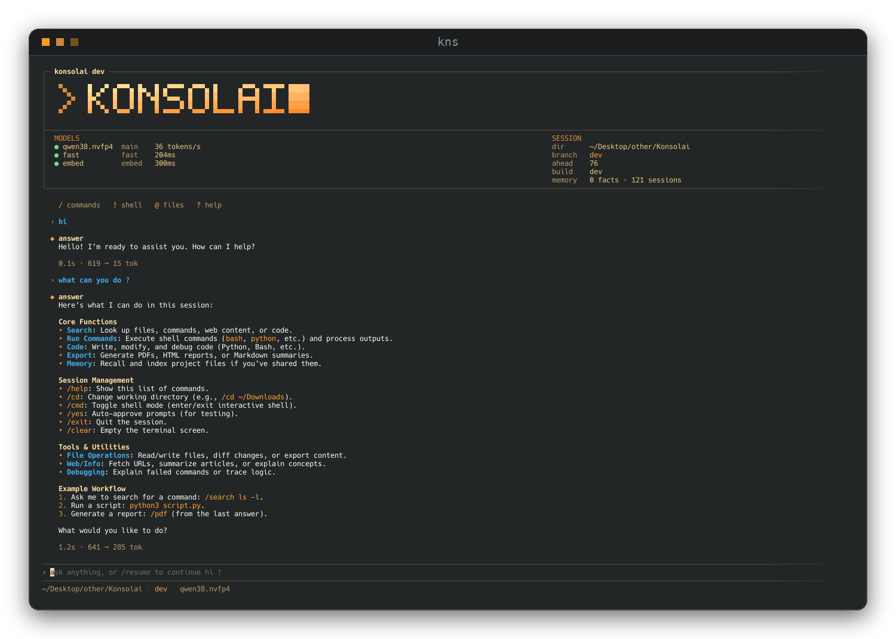
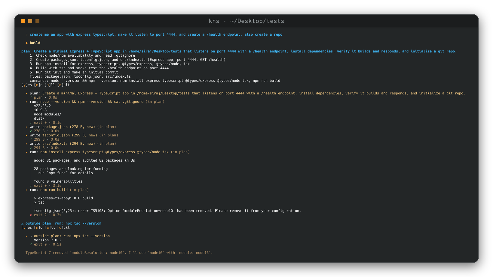
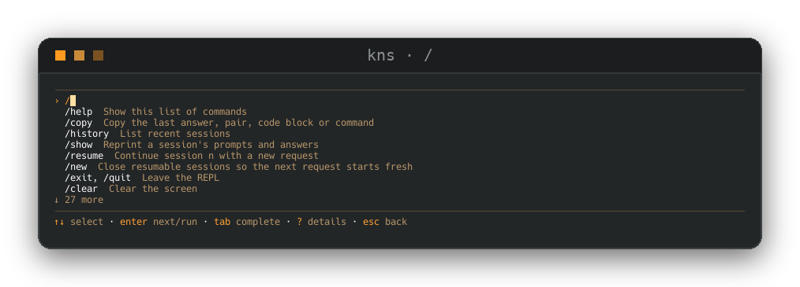
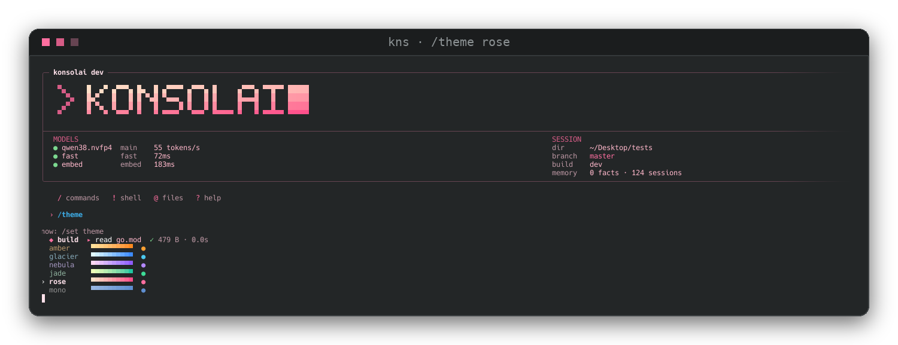

<h1 align="center">
  
</h1>

<p align="center">
  Local coding agent for your terminal.<br>
  Plan-first builds, explicit approvals, any OpenAI-compatible model server.
</p>

<p align="center">
  <a href="https://github.com/SniksaX/Konsolai/releases"></a>
  <a href="LICENSE"></a>
  
  
</p>

**Latest release: [v0.4.0](https://github.com/SniksaX/Konsolai/releases/tag/v0.4.0)** · [Release notes and downloads](https://github.com/SniksaX/Konsolai/releases/latest) · [Changelog](CHANGELOG.md)

## Quick start

### 1. Install

The release binary is the shortest path. Download it with the published SHA256SUMS, verify it, then install it on your PATH.

```sh
curl -fsSLO https://github.com/SniksaX/Konsolai/releases/download/v0.5.0/konsolai-linux-amd64
curl -fsSLO https://github.com/SniksaX/Konsolai/releases/download/v0.5.0/SHA256SUMS
sha256sum -c SHA256SUMS --ignore-missing
install -m 0755 konsolai-linux-amd64 ~/.local/bin/konsolai
export PATH="$HOME/.local/bin:$PATH"
```

Other install paths:

| Path | Command | Notes |
| --- | --- | --- |
| Docker image | `docker run --rm -it --user "$(id -u):$(id -g)" -v "$PWD":/work -v "$PWD/config.yaml":/config/config.yaml ghcr.io/sniksax/konsolai:v0.5.0` | Mount a config file before the first run. The `-full` tag adds Chromium for PDF export. |
| Go install | `go install github.com/SniksaX/Konsolai/cmd/konsolai@v0.5.0` | Installs into `$(go env GOPATH)/bin`. |
| Source build | `git clone https://github.com/SniksaX/Konsolai.git && cd Konsolai && scripts/build.sh` | Needs the Go version in `go.mod`; writes `~/.local/bin/konsolai`. |

### 2. Point it at a model server

Konsolai talks to any OpenAI-compatible chat endpoint. Add the server you run, then make it the main role:

```sh
# vLLM, default port 8000
konsolai /set model add vllm http://localhost:8000/v1

# llama.cpp server, default port 8080
konsolai /set model add llamacpp http://localhost:8080/v1

# Ollama, default port 11434
konsolai /set model add ollama http://localhost:11434/v1

konsolai /set model main vllm
```

The optional third argument is the model id; leave it empty to use the first id returned by `<endpoint>/models`. `konsolai /set model discover` lists the ids each endpoint offers.

For an API-key provider, the preset fills the endpoint and request quirks, and the key is stored outside the repo:

```sh
konsolai /set model add gpt --provider openai   # or openrouter, groq, together, mistral, deepseek, gemini, anthropic
konsolai /set key gpt                            # hidden input, saved to ~/.config/konsolai/secrets (0600)
konsolai /set model main gpt
```

`api_key_env` names an environment variable read at call time; when it is unset the secrets file is used. A model whose host resolves to a public address is marked `remote`, and embeddings must stay loopback or private.

### 3. Run it

```sh
konsolai
```

With no request, and stdin and stdout on a TTY, it starts the REPL. One request runs one turn:

```sh
konsolai "add a health check handler"
```

## First run

With no config file, Konsolai starts on the built-in defaults: one model named `default` at `http://localhost:8000/v1`, memory off, and no embeddings. `/config init` writes that default file when you want to edit it as YAML.

If no model server is listening, the REPL still starts. The first request stops with one line:

```
konsolai: a model probe could not reach localhost:8000; this turn made no chat call. Run /doctor to check the endpoint.
```

`/doctor` checks the config file and its mode, the main and fast endpoints, the embedding and rerank endpoints, the database, Chromium, the clipboard backend, git, and the terminal. Every failed check prints its own fix.

```sh
konsolai /doctor
```

## Requirements

Konsolai requires one OpenAI-compatible chat endpoint. Everything else is optional.

| Component | Needed for | Notes |
| --- | --- | --- |
| OpenAI-compatible chat server | Every request | vLLM, llama.cpp, Ollama, or any server that serves `/v1/chat/completions` and `/v1/models`. |
| Go 1.27.1 | Build from source only | The version in `go.mod`. Release binaries and the Docker image already include the toolchain. |
| Postgres with pgvector | Memory and RAG | Off when `database.url` is empty. `docker compose up -d` starts a local one. |
| Embedding and rerank servers | RAG recall | Both are optional. The client posts `/embed` and `/rerank`. |
| Headless Chromium | PDF and Mermaid export | `/pdf`, `/pdf` from a plan, and `export_doc`. `KONSOLAI_CHROME` overrides the search. |
| Clipboard tool | `/copy` | `wl-copy`, `xclip`, `xsel`, or OSC 52 on the TTY. |

## Features

- A welcome screen with the current model, memory state, and recent sessions for the project.
- A plan before every build turn, one approval, then visible steps and a recovery path when a step fails.
- One command registry for the REPL and one-shot use, with `/` completion and an inline help screen.
- Six palettes and three welcome layouts, applied without restarting.









## Cloud models

Konsolai also talks to remote OpenAI-compatible providers. A model whose host resolves to a public address is `remote`; loopback and private addresses stay local. A remote model is marked `remote` in `/set model`, `/status`, and the welcome; the footer marks the model that served the last call when it is remote, and `/doctor` reports each one. The presets fill the endpoint and request quirks:

```sh
konsolai /set model add gpt --provider openai   # also openrouter, groq, together, mistral, deepseek, gemini, anthropic
konsolai /set key gpt                            # hidden input, saved to ~/.config/konsolai/secrets (0600)
konsolai /set model main gpt
```

The key never goes into `config.yaml`. `api_key_env` names an environment variable that is read at call time; when it is unset, the secrets file is used. Remote use is allowed by default and gated by `privacy.allow_remote` (`true`), `privacy.remote_roles` (`main`, `fast`), and `privacy.session_token_cap` (`0` = off). The first remote call in a process asks once:

```
this sends your prompts and file contents to api.openai.com [y/N]:
```

In the REPL the question uses the normal editor, so Ctrl+C or Ctrl+D means no; a one-shot run reads the answer from stdin. Only y/yes agrees, and a no refuses every remote model for the rest of the process. `--yes` skips the question; a non-interactive run without `--yes` refuses the remote model before sending anything. What leaves the machine is the prompts and attached file contents, not your config or the key; a key over plain HTTP to a non-local host is refused.

Set `price_in` or `price_out` (USD per million tokens) on a remote model to add the turn cost (for example `$0.015`) to the end-of-turn stats line and the `--trace` stats line; a local or unpriced model shows none. The `anthropic` preset is experimental: its OpenAI-compatible auth header has not been verified.

Full details: [docs/configuration.md](docs/configuration.md#cloud-models).

## MCP servers

Konsolai is a Model Context Protocol client. A server is a local stdio command or a streamable HTTP endpoint, and its tools join `lookup`, `act`, and `build` turns (never `answer`):

```sh
konsolai /set mcp add stdio files npx -y @modelcontextprotocol/server-filesystem /data/projects
konsolai /set mcp trust files read_only
konsolai /mcp
konsolai /mcp tools files
konsolai /mcp test files
```

Servers can be scoped by trust (`ask`, `read_only`, `auto`), tool globs and a per-server timeout; env and header values take `${ENV_VAR}` references instead of literals, and `/set mcp` refuses a value that looks like a stored secret. `/mcp tools <name>` shows each tool with its read-only or mutating classification and why a tool is hidden, and `/mcp test <name>` connects once and reports the latency and tool count. In a planned turn the plan lists the MCP tools it will call; anything else is outside the plan. Above `mcp.max_inline_tools` the model searches with `mcp_find_tool` and can call a tool it found in the same turn. `private` servers stay away from a remote main model unless you confirm them or pass `--yes`. The welcome shows `mcp N configured` until a server connects and then `U/T up` over the configured servers, `/status` and `/doctor` add per-server rows, and `--trace` counts MCP calls on the stats line.

Setup, trust levels, filesystem and database examples, and the threat model are in [docs/mcp.md](docs/mcp.md).

## Configuration

Configuration lives in `config.yaml`: `/config init` writes it, `/set` changes it, and `/config path` prints the file in use. Profiles, the environment variables for containers and CI, the full friendly-name table, and the model roles are in [docs/configuration.md](docs/configuration.md).

A new setting is one entry in `internal/config/keys.go`. Secrets are refused: a database password belongs in `~/.pgpass` or `KONSOLAI_DATABASE_URL`.

## Commands

The REPL and one-shot forms share one registry. Requests fall into four intents (`answer`, `lookup`, `act`, `build`), and every command appears in the slash table. The full slash table, REPL details, one-shot stdin rules, exit codes, memory commands, and export are in [docs/commands.md](docs/commands.md).

## Safety

Build turns are planned and approved before any write. Act turns need a plan only at high effort. After approval, writes and shell commands are checked against the plan; anything outside it is confirmed again. Sensitive paths, dangerous commands, and stored secrets are filtered. The full model, with the denylists and the redaction rules, is in [docs/safety.md](docs/safety.md).

## Troubleshooting

| Symptom | What to do |
| --- | --- |
| `konsolai: command not found` | The install directory is not on `PATH`. Add it (`export PATH="$HOME/.local/bin:$PATH"`) and check with `konsolai --version`. |
| Cannot reach the model server | Run `konsolai /doctor`. Check that the endpoint answers `<endpoint>/models`, that it ends in `/v1`, and that the model id exists. In a container, the host is `host.docker.internal`, not `localhost`. |
| Memory offline | Memory is off when `database.url` is empty, or it disables itself after the first store error and prints one line. Start the local database with `docker compose up -d`, then check `konsolai /doctor`. |
| Where is the config file? | `konsolai /config path` prints the active path and the resolved path. Order: `--config`, then `KONSOLAI_CONFIG`, then `$XDG_CONFIG_HOME/konsolai/config.yaml` or `~/.config/konsolai/config.yaml`. |
| Something else is wrong | Run `konsolai /doctor` first. Each `✗` line carries the fix it expects. |

## Development

Leaves do not import `konsolai/internal`. The TTY side is `ui`, `banner`, `repl`, `shellmode`, `commands`, and `cmd/konsolai`; a turn is `intent`, `turn`, `agent`, and `tools`; persistence is `store`, `memory`, `rag`, and `welcome`. Tests that need Postgres read `KONSOLAI_TEST_DATABASE_URL`; `scripts/test-db.sh up` starts a throwaway database.

Commits go to `dev` only, one commit per file, with `[TYPE|SIZE] Title`. The working rules and the decisions that must not regress are in [AGENTS.md](AGENTS.md).

## License

MIT. See [LICENSE](LICENSE).
